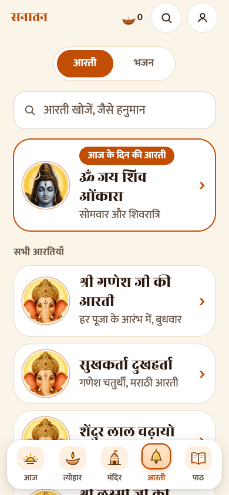
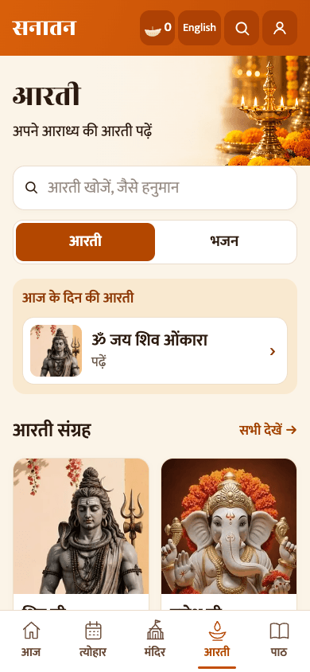
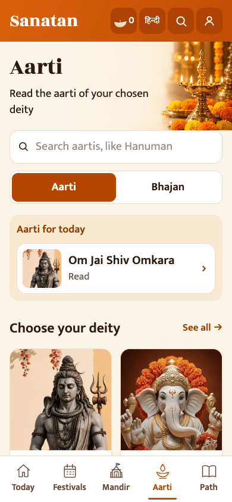

# Sanatan redesign review

Ayush selected Today from option 4, Mandir from option 5, and the saffron-and-ivory palette. The latest Aarti and Festival mockups remove aarti resume-reading UI, the forced middle festival card, and repeated city/year selectors. Existing prayers, meanings, temple content, storage keys and hash links must remain intact.

## Delivery order

1. Shared header/navigation and Aarti library
2. Path and Festivals
3. Today and Mandir
4. Once-a-day opener, before Mandir doors
5. Detail/daily-sheet sharing cards

Each change is reviewed against a phone screenshot and checked with TypeScript, Vitest, and the production build. PRs target `app-source` and are intended for review/merge in that order. No deployment or hosting changes are included.

## Part 1

The saffron header now appears on every route, with the existing darshan counter/calendar, search, profile, and a direct Hindi/English toggle. Bottom navigation has exactly five labelled outline icons and an orange active underline.

The Aarti library has a photographic heading, search, Aarti/Bhajan switch, today's aartis, deity grid/filter and the complete existing catalogue. It has no continue-reading prompt. Existing readers, meaning switch and official tap-to-play YouTube cards remain unchanged. Deities still use `src/content/deities.ts`; missing pictures fall back to a diya.

The decorative lamp background is generated artwork, not a photograph of a named temple or a new religious claim. It contains no devotional text and is not used as deity imagery on shared cards.

Validation: Node 22; `npx tsc -b`, all 11 existing Vitest tests, and `npm run build` passed. Browser checks covered Hindi/English, English-name search, opening a reader, bhajan search, deity filtering, five tabs, and 320/390px layouts at enlarged text. The existing large-main-bundle warning remains.

Before and after (390 × 844):

| Before | After | English |
| --- | --- | --- |
|  |  |  |

Missing artwork: the existing deities without their own photo continue to use a diya. This PR does not invent replacement deity identities or alter sacred text.
