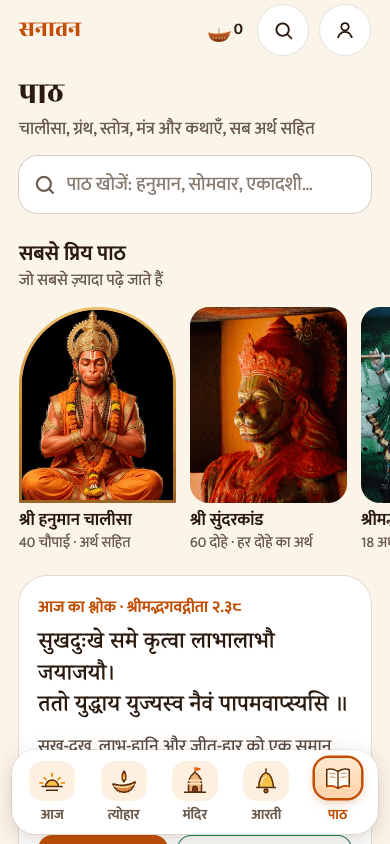
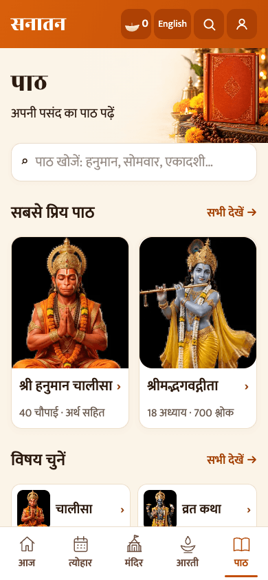
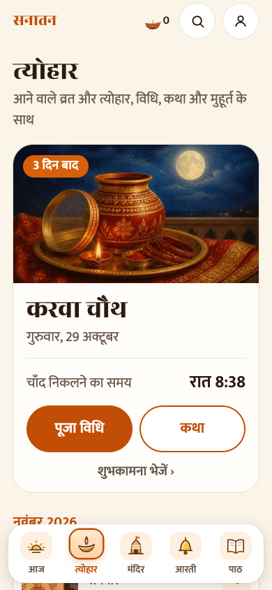
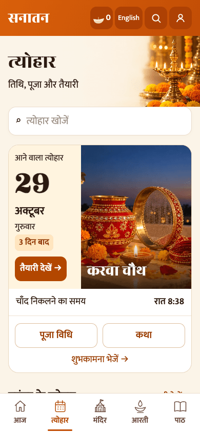

# Path and Festivals

This step builds on PR 1's shared components. Path keeps the original Sanskrit, meanings, Gita chapter routes and every library text. It adds full-size popular covers, topic collection pages and a complete searchable collection. Its daily shloka rotation is extracted unchanged for reuse on Today and the daily sheet.

Festivals keep the existing date dataset and city-based calculations. The next festival has a compact date/photo card, countdown, useful time, puja vidhi, katha and greeting entry. All other existing festivals remain accessible through month grids and search; the full calendar opens inside the app. City/year selectors are not repeated on these root screens.

Generated decorative assets: blank scripture-book heading and a Karwa Chauth object still life. They add no scripture or factual ritual instructions. Existing deity pictures remain in use.

| Screen | Before | After |
| --- | --- | --- |
| Path |  |  |
| Festivals |  |  |

Checks: Node 22 TypeScript, all 11 existing Vitest tests, production build. Browser flows: topic collection → existing reader, Gita chapter, full library, festival vidhi/katha, English-name festival search, calendar, and 320px layout. The 2026 festival dataset still ends in November; extending it requires separately reviewed content. No sacred text or festival date was changed.
